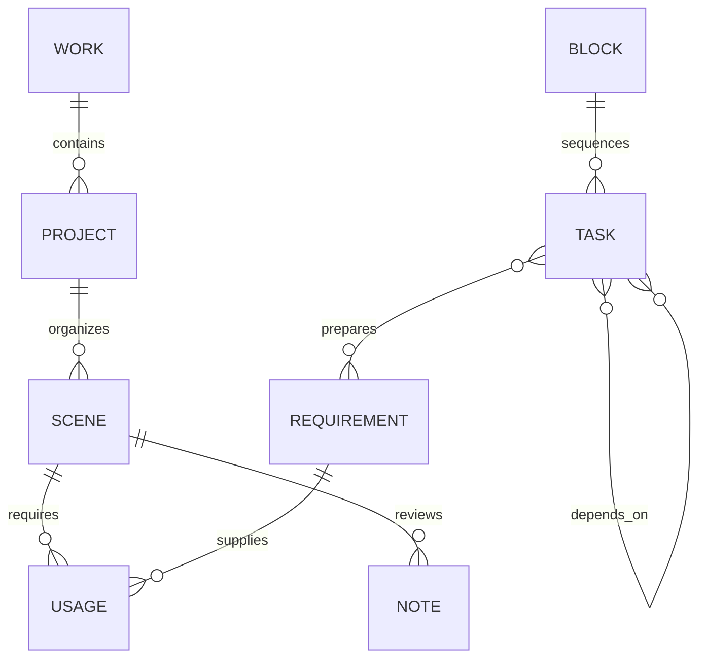

# 领域与本体设计

## Owner与核心本体

| Owner | 拥有的事实 |
| --- | --- |
| 宿主Core | WorkRef、固定来源、正式人物和正文、素材、修订、CAS、原键与作者决定 |
| 本插件 | 场次拆解、制作需求、数量单位、准备任务、批次、专业意见和派生交付 |
| 外部Agent | 理解、语义抽取、估算建议、专业创作及接续编排 |
| 作者 | 创作取舍、估算依据、素材选用、内容外发、费用和定稿 |

scene表示当前筹备中的场次，不替代宿主正式场次。requirement表示制作所需资源；usage以scene_id与requirement_id连接数量和单位。task持有准备工作、依赖、工时和费用。block是单通道串行准备批次。note固定完整场次及相关需求与任务摘要，防止旧意见静默应用新稿。

## 不变量

集合局部ID唯一；页内外键真实存在。usage的场次＋需求组合唯一，防止重复计量；不同场次的非消耗资源不合计为采购量，不同单位分别显示。所有task依赖必须存在、无环；done任务的所有前置也必须done，blocked必须说明原因。

每个task最多分配一个批次，批次顺序唯一。同批按拓扑序执行，前置不得放到更晚批次。尚未分配与未知工时明确报告，不强行排满。已完成任务保留原估算用于计划回顾，不伪造实际工时或支付金额。

需求实体须以entity_ref与entity_source_index成对引用固定设定；素材按asset_source_indices回读。相同名称或ID不推出同一人物，prepared不执行宿主资产采用。无来源场次明确显示待定位，可保存创作草案但不声称已对照剧本。

## 版本与返工

来源索引只能追加；新稿另建固定来源。preview_source_change只比较旧引文在新版相同字节范围是否完全一致，变化或位移都标为需要Agent复读，不声称语义自动对齐。影响沿显式需求与任务依赖传播，未登记关系不在自动检查覆盖内。

逻辑关系存于一个受管专业对象；不新增独立数据库、全局资源事实或权限系统。
