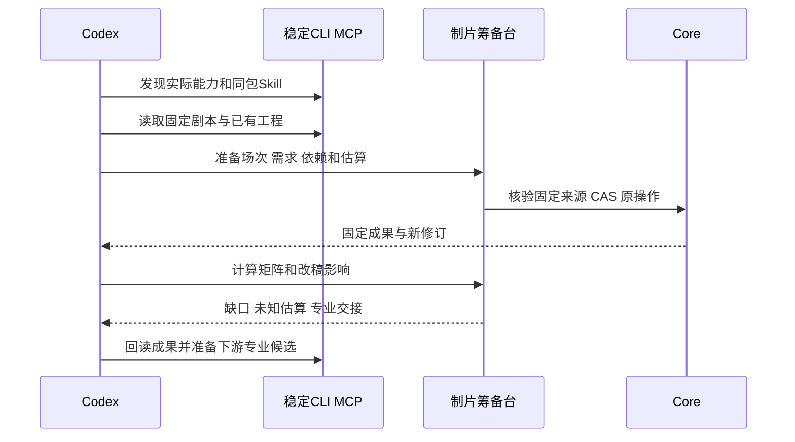

# 数据与API设计

## 格式与数据库设计

可执行字段、闭合对象、枚举与上限以[plugin-manifest.json](../contracts/plugin-manifest.json)为唯一Owner。manifest_version=1、Host API=1、专业schema_version=1.0.0、format_version=1。字段错误由Ajv预编译校验拒绝；专业不变量同时约束整本保存和细粒度动作。

| 根字段 | 含义 |
| --- | --- |
| title、currency | 工程标题与CNY／USD／EUR单一币种，费用单位为分或cent |
| scenes | 顺序、内外景、时段、摘要与固定UTF-8原文区间 |
| requirements | 部门、声明准备状态、说明、固定实体与素材来源 |
| usages | 场次、需求、数量、单位和场次要求 |
| tasks | 场次与需求关联、前置任务、状态、未知可空的工时与费用 |
| blocks | 顺序、任务集合与可空的准备容量 |
| notes | 场次摘要、原话、处理状态与说明 |
| basis_refs | 其他专业工程的固定Owner／对象／修订／摘要 |

单对象512KiB，最多100来源；场次300、需求300、关联1000、任务300、批次100、意见300。超限按实际创作范围拆成多个专业工程。大报告分块读取并核验完整和分块SHA-256，不以内联大媒体挤占对象预算。

Core已有专业对象、不可变修订、来源索引与原操作回执承担持久化。唯一键为WorkRef＋owner_plugin_id＋object_id；修订按object_id＋revision定位并核验sha256。插件不管理SQL表或迁移。

## API与事务

先发现安装版能力和同包Skill，再以WorkRef、management_ref、plugin_id、package_sha256、capabilities_sha256调用hetu.plugins.invoke。全部动作和逐字段参数见[功能清单](../CAPABILITIES.md)，包含保存、各集合维护、Fountain场次导入、矩阵、计划计算、改稿影响、专业交接和导出。

新建expected_revision=0且expected_sha256为空；更新携带回读的修订与摘要。写入保留operation_key。未知先查get_operation；只有确切not_found才沿原键原输入恢复。同键异参拒绝，CAS冲突不覆盖作者新稿。get_source验证UTF-8边界，export_preparation按原字节分块。

estimated_cost_minor是非负安全整数，求和逐步验证安全范围；空值单独计数。单币种工程不做汇率换算，不把估算变成计费授权。

## 与既有专业包的固定关联

美术包接收结构化basis_ref。既有导演与视听Schema未声明该字段时，不注入非法字段；派生制作说明保留固定筹备标识，筹备的新修订通过basis_refs固定回读下游结果。共享SDK逐项核验Owner与摘要，不把说明文本当成自动验证的依赖关系。
