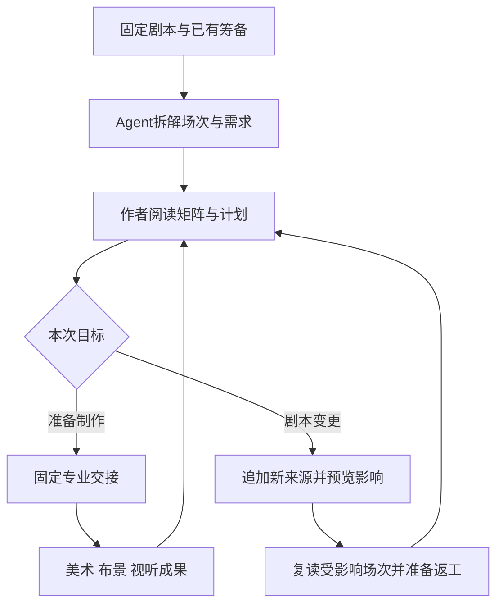

# 工作面与交互设计

## 信息结构

独立工作面，左上角返回作品，页头紧凑；默认围绕成果审阅，AI交接持续可达。作者不用先学排期表或重复录入会话内容。高级JSON编辑只作补充。

| 页签 | 工作面 |
| --- | --- |
| 场次拆解 | 有序场次、内外景与时段、摘要、固定来源和场次制作单 |
| 制作需求 | 按场次与部门阅读资源矩阵、数量单位、声明准备状态及缺口 |
| 准备计划 | 拓扑依赖图、任务状态、串行批次、未知工时与费用、容量检查 |
| 改稿与意见 | 显式选择旧新来源、查看影响及原意见，不自动迁移旧坐标 |
| 专业交接 | 为选定场次准备美术／布景／视听投影，导出完整离线筹备包 |

复用河图共享Radix语义色和静止柔和渐变，文字阅读与输入实色。字号12／14／20px，容器0.5px边框，无装饰动画。表格窄屏变为可读列表，不截断关键状态；依赖图为辅助视图，不是必经操作。

## 状态与恢复

加载保持结构；空状态说明缺什么和下一步；业务错误就地呈现。后台读取与用户写操作串行排队，避免同包执行冲突。未知写入保留原键回读，CAS冲突保留输入并显式重建基线；关闭重开可恢复未保存稿。

实际浅暗、1360与760、全部页签、键盘、减少透明度和恢复旅程逐项验证。设计判断与自动尺寸断言分别记录，不以能加载页面代替验收。
