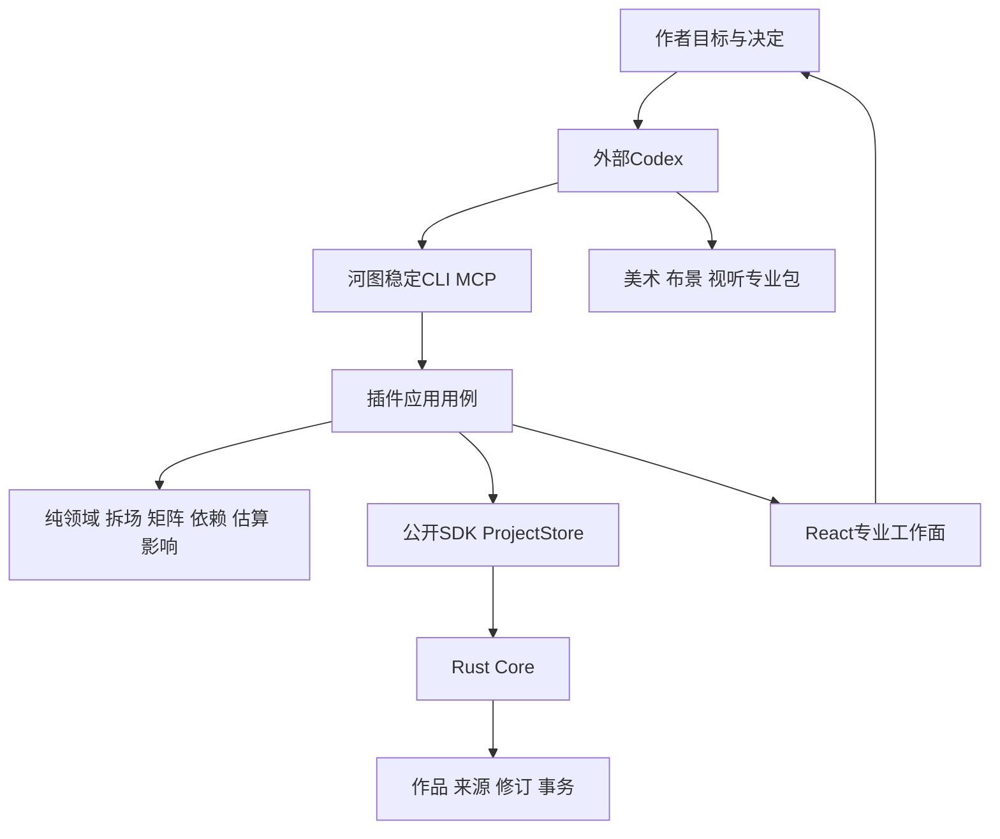

# 架构与技术选型

## 分层架构

| 层 | 技术 | 取舍 |
| --- | --- | --- |
| 纯领域 | TypeScript确定性函数 | 场次识别、矩阵、拓扑序、估算与影响不依赖GUI或数据库 |
| 合同 | JSON Schema Draft-07与Ajv预编译 | 同一可执行合同供机器发现、保存校验与操作地图 |
| 应用 | 公开SDK和ProjectStore | 身份、来源、CAS、原键由Core校验，不复制作品库 |
| 界面 | React18、共享Radix语义样式 | 表格、依赖图和场次制作单来自同一工程 |
| 运行 | 受管Node25、宿主Cordis生命周期 | 本包apply/effect/invoke，不自行安装调度框架或FFI |
| 分发 | GitHub固定发行与河图目录 | 宿主和专业包独立迭代，逐版本取得验收 |

最小模型保留场次、需求、关联、任务、批次、意见六类专业记录。费用只在任务上估算，避免资源和任务双计。批次单通道串行，不宣称资源约束最优排期；专业算法缺的前提由Agent补读，不增加伪智能规则。

KISS保持一个专业聚合与一套事务；DRY让宿主管作品与固定来源；SOLID使领域、应用、视图和发行分别承担职责；YAGNI不新增交易、日历、团队权限或调度服务。相同JS/TS技术栈不意味DSH原包直接兼容。
